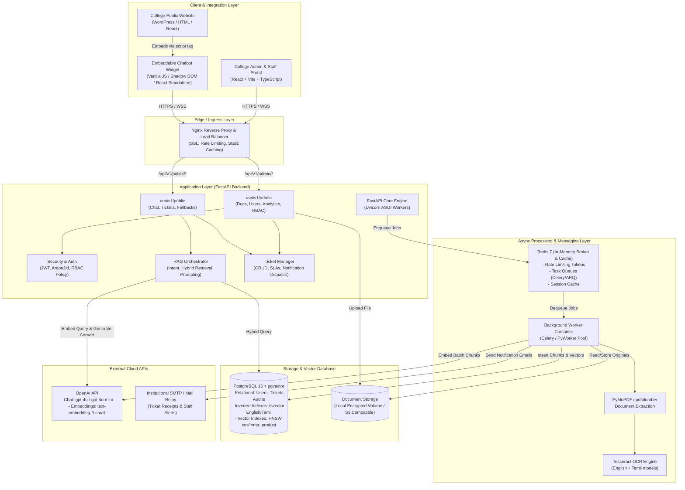
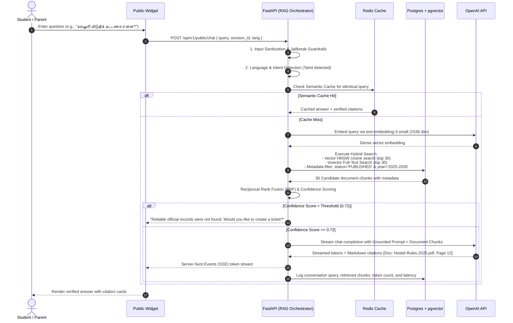
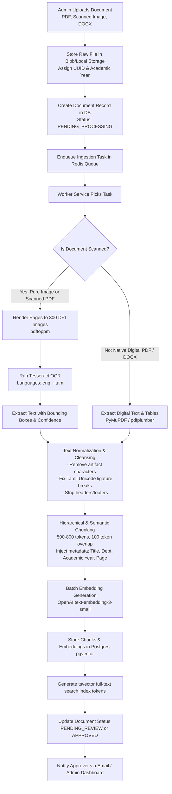

# System Architecture Specification: College AI Help Desk

## 1. High-Level Architectural Blueprint

The **College AI Help Desk** uses a decoupled, event-driven, micro-modular architecture designed for high availability, low-latency conversational inference, and strict security isolation between public visitors and authenticated college staff.



---

## 2. Component Decoupling & Isolation

### 2.1 Public Chatbot Widget vs. Protected Admin Dashboard
1. **Public Widget**:
   - **Isolation**: Compiled into a single, zero-dependency bundle (`widget.js`) with styles encapsulated inside a **Shadow DOM** (`AttachShadow({ mode: 'closed' })`). This guarantees that the host college website's CSS cannot distort the widget, nor can the widget leak styles into the parent page.
   - **Authentication**: Zero authentication requirements. Communication uses an ephemeral `session_id` (UUIDv4) stored in browser `sessionStorage`.
   - **Surface Area**: Can only reach public endpoints:
     - `POST /api/v1/public/chat`
     - `POST /api/v1/public/tickets`
     - `GET /api/v1/public/health`
2. **Protected Admin Dashboard**:
   - **Isolation**: Served from a dedicated subpath (`/admin/`) or distinct administrative subdomain (`admin.college.edu`).
   - **Authentication**: Strict cookie-based or bearer-token-based JWT with Argon2id credentials, CSRF tokens, and role-based claim checks.
   - **Surface Area**: Complete administrative control: Document uploads, version approvals, vector re-indexing, user lifecycle, ticket triage, and system telemetry.

---

## 3. RAG Pipeline Architecture

The Retrieval-Augmented Generation pipeline is engineered to balance sub-second retrieval speeds, cross-lingual precision (Tamil and English), and strict citation grounding.



---

## 4. Document Ingestion, Parsing & OCR Pipeline

The ingestion pipeline converts disparate institutional documents into clean, chunked, searchable knowledge vectors.



### 4.1 Chunking Strategy
- **Token Target**: 500 to 800 tokens per chunk.
- **Overlap**: 100 to 120 tokens (15–20%) to preserve cross-boundary semantic context.
- **Context Injection**: Each chunk is prepended with standard structural metadata before vectorization:
  ```text
  [DOCUMENT: B.E. Regulations 2025-2026]
  [DEPARTMENT: Academic Affairs]
  [SECTION: 4.2 Attendance and Condonation Rules]
  [PAGE: 14]
  ---
  <Extracted chunk text content>
  ```
- **Table Preservation**: Tables in fee circulars and exam schedules are extracted and serialized into clean GitHub-flavored Markdown tables to preserve column-row relationships in both vector and keyword representations.

---

## 5. Background Processing: Worker Architecture

### 5.1 Decision: Celery vs. ARQ
- **Decision**: **Celery with Redis Broker and SQLAlchemy Result Backend**.
- **Rationale**:
  1. Celery provides battle-tested worker pooling (`prefork` or `gevent`), task rate-limiting, and task routing.
  2. Heavy CPU/memory tasks (PyMuPDF rendering, Tesseract OCR for 50-page PDFs) benefit from pre-forked worker processes separate from async I/O web servers.
  3. Built-in support for retries with exponential backoff, dead-letter queues, and task monitoring via Flower or Prometheus metrics.
- **Task Queues**:
  - `queue_ingestion`: High-memory, CPU-bound PDF parsing, OCR, and embedding generation.
  - `queue_notifications`: Low-latency I/O tasks for SMTP email delivery.
  - `queue_maintenance`: Periodic background tasks (e.g., pruning old guest chat logs, refreshing search statistics).

---

## 6. Hybrid Vector & Full-Text Search Architecture

1. **Dense Vector Search**:
   - `pgvector` extension configured with **HNSW (Hierarchical Navigable Small World)** indexing.
   - Distance metric: Cosine distance (`vector_cosine_ops`) or Inner Product on normalized vectors.
   - HNSW parameters: `m = 16`, `ef_construction = 64` for high recall ($> 98\%$) and low query latency ($< 15\text{ ms}$).
2. **Sparse Lexical Search**:
   - PostgreSQL native `tsvector` with `tsquery`.
   - Dual dictionaries: PostgreSQL English dictionary + custom simple/Tamil lexeme tokenization.
   - GIN index on `search_vector` for millisecond keyword lookups (e.g., exact course codes "CS8501", fee amounts "₹45,000", or faculty names).
3. **Reciprocal Rank Fusion (RRF)**:
   For every candidate chunk $d$:
   $$\text{RRF Score}(d) = \frac{1}{k + \text{Rank}_{\text{dense}}(d)} + \frac{1}{k + \text{Rank}_{\text{sparse}}(d)}$$
   where $k = 60$. Chunks are sorted by descending RRF score, and the top $N=5$ chunks are passed to the reranking/prompt context window.

---

## 7. Multilingual Strategy (English & Tamil)

1. **Input Detection**: Fast lightweight language identification (`langdetect` or fast regex/unicode script detection for Tamil unicode block `\u0B80-\u0BFF`).
2. **Query Normalization**:
   - Pure Tamil queries: Cleaned and normalized to standard Tamil Unicode NFC form.
   - Tanglish (Tamil written in Latin script, e.g., "Hostel fees evvalavu?"): Detected via prompt instructions; the LLM normalizes intent into both Tamil and English retrieval search terms before running hybrid search.
3. **Grounding & Answering**:
   - The LLM is instructed: *"Respond in the exact language or dialect specified by the user (Tamil script for Tamil queries, English for English queries). Use only the verified context. Do not invent any facts."*
4. **OCR**: Tesseract OCR loaded with dual language flags `-l eng+tam` so circulars featuring bilingual headings and Tamil government directives are transcribed without corrupted glyphs.

---

## 8. Network, Reverse Proxy & Caching Strategy

```text
Internet / Client Requests
        │
        ▼
[ Nginx Reverse Proxy / Port 80 & 443 ]
   ├── Rate Limiter Zone: 15 req/min per IP on /api/v1/public/chat
   ├── SSL Termination (TLS 1.3, HSTS)
   ├── Static Asset Cache: widget.js (Cache-Control: public, max-age=3600, stale-while-revalidate)
   ├── Routing /widget/* -> Static bundle
   ├── Routing /admin/*  -> React Admin SPA (index.html fallback)
   └── Routing /api/*    -> FastAPI ASGI Cluster (Uvicorn: 4 workers)
```

- **Semantic Cache in Redis**: Query hashes and high-similarity questions ($> 0.98$ embedding cosine similarity) have their generated responses cached with a 12-hour TTL. Any document update triggers an immediate cache invalidation for the affected department/academic year.

---

## 9. Backend Directory & Codebase Layout (Referenced from ARC100 Pattern)

To maintain clean modular boundaries and align with the proven engineering standards from `/home/ybdeveloper/Ramesh-Test123/ARC100/code/backend`, the backend is organized into a modular service topology:

```text
backend/
├── docker-compose.yml              # Local and production multi-container orchestration
├── Dockerfile                      # Web API container build
├── Dockerfile.worker               # Celery worker container with Tesseract & Poppler
├── requirements.txt                # Root-level pinned dependencies
├── scripts/                        # Operational and maintenance automation
│   ├── start_all.sh                # Boot backend, worker, DB, and redis
│   ├── stop_all.sh                 # Graceful shutdown script
│   ├── backup.sh                   # Automated pg_dump snapshot script
│   ├── restore_drill.sh            # Backup restoration verification test
│   ├── smoke_test.sh               # Health check and ping test suite
│   └── lint_all.sh                 # flake8 / black / ruff / mypy check
├── backups/                        # Local snapshot storage (.dump files)
├── docs/                           # Architecture, database schema, and API specs
├── logs/                           # Runtime log sinks (api_gateway.log, worker.log)
└── Services/
    └── HelpdeskService/            # Core backend application package
        ├── main.py                 # FastAPI initialization, lifespan DB init, CORS, error handlers
        ├── Dockerfile              # Service-specific build definition
        ├── requirements.txt        # Service Python dependencies
        ├── pytest.ini              # Pytest configuration
        ├── configs/                # Environment-driven configuration hierarchy
        │   ├── __init__.py
        │   ├── base_config.py      # Base settings (JWT expiry, model names, defaults)
        │   ├── dev_config.py       # Development environment overrides
        │   └── local_config.py     # Local developer overrides
        ├── models/                 # SQLAlchemy 2.0 ORM Declarative Models
        │   ├── __init__.py         # Base, async engine, and sessionmaker exports
        │   └── models.py           # Users, Documents, Chunks, Tickets, Messages, Audits
        ├── resources/              # Controller & Service domain logic
        │   ├── __init__.py
        │   ├── authController.py   # Login, refresh, logout, password verification
        │   ├── chatController.py   # Public chat query & SSE streaming handler
        │   ├── documentController.py # Ingestion, approval, and archive workflows
        │   ├── ticketController.py # Ticket CRUD, triage, and message threads
        │   ├── analyticsController.py # Token usage, query clustering, cost metrics
        │   ├── aiService.py        # OpenAI API client, embeddings, prompt construction
        │   ├── ragService.py       # RRF hybrid search, confidence evaluation (τ ≥ 0.72)
        │   ├── ocrService.py       # Tesseract bilingual (eng + tam) & PDF extraction
        │   ├── notificationService.py # SMTP email dispatch helper
        │   ├── schemas.py          # Pydantic v2 validation models
        │   ├── errors.py           # Standardized error classes and exception handlers
        │   └── utils.py            # Argon2id password hashing, JWT generation, PII masking
        ├── routes/                 # Route registrations & path prefixes
        │   └── __init__.py         # Maps /api/v1/public/*, /api/v1/admin/*, /api/auth/*
        └── tests/                  # Automated pytest test suites
            ├── __init__.py
            ├── conftest.py         # Test fixtures, mock DB session, test client
            ├── test_auth.py        # Authentication & RBAC test cases
            ├── test_chat.py        # Chat queries & fallback trigger tests
            ├── test_documents.py   # Document upload, chunking & approval tests
            ├── test_tickets.py     # Ticket workflows and email notification tests
            ├── test_hybrid_search.py # pgvector HNSW + tsvector RRF search tests
            └── test_rag_eval.py    # Faithfulness and citation precision benchmarks
```

