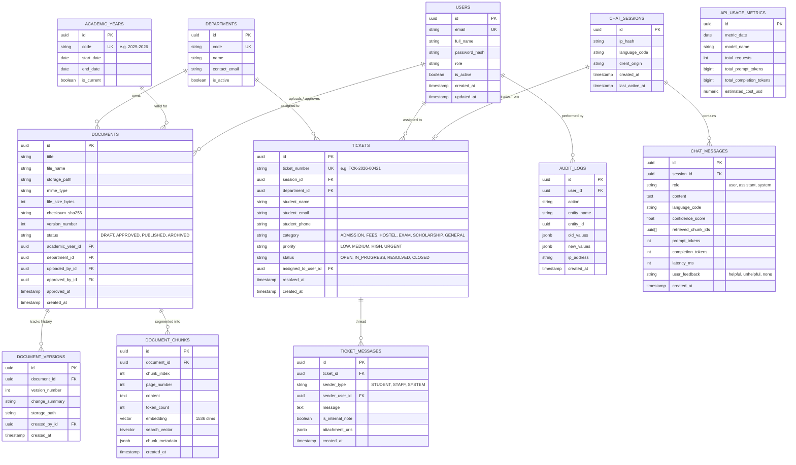

# Database Schema Specification: PostgreSQL & pgvector

## 1. Entity Relationship (ER) Diagram



---

## 2. Table Schemas, Types & Constraints

### 2.1 Extension Initialization
```sql
CREATE EXTENSION IF NOT EXISTS "uuid-ossp";
CREATE EXTENSION IF NOT EXISTS "pgcrypto";
CREATE EXTENSION IF NOT EXISTS "vector";
```

### 2.2 Users & Authentication (`users`)
```sql
CREATE TYPE user_role_enum AS ENUM (
    'SUPER_ADMIN',
    'CONTENT_APPROVER',
    'SUPPORT_AGENT',
    'AUDITOR'
);

CREATE TABLE users (
    id UUID PRIMARY KEY DEFAULT gen_random_uuid(),
    email VARCHAR(255) NOT NULL UNIQUE,
    full_name VARCHAR(150) NOT NULL,
    password_hash VARCHAR(255) NOT NULL,
    role user_role_enum NOT NULL DEFAULT 'SUPPORT_AGENT',
    department_id UUID REFERENCES departments(id) ON DELETE SET NULL,
    is_active BOOLEAN NOT NULL DEFAULT TRUE,
    created_at TIMESTAMPTZ NOT NULL DEFAULT CURRENT_TIMESTAMP,
    updated_at TIMESTAMPTZ NOT NULL DEFAULT CURRENT_TIMESTAMP
);

CREATE INDEX idx_users_email ON users(email);
CREATE INDEX idx_users_role ON users(role);
```

### 2.3 Departments (`departments`)
```sql
CREATE TABLE departments (
    id UUID PRIMARY KEY DEFAULT gen_random_uuid(),
    code VARCHAR(50) NOT NULL UNIQUE,
    name VARCHAR(150) NOT NULL,
    contact_email VARCHAR(255) NOT NULL,
    is_active BOOLEAN NOT NULL DEFAULT TRUE,
    created_at TIMESTAMPTZ NOT NULL DEFAULT CURRENT_TIMESTAMP
);

CREATE INDEX idx_departments_code ON departments(code);
```

### 2.4 Academic Years (`academic_years`)
```sql
CREATE TABLE academic_years (
    id UUID PRIMARY KEY DEFAULT gen_random_uuid(),
    code VARCHAR(20) NOT NULL UNIQUE, -- e.g. "2025-2026"
    start_date DATE NOT NULL,
    end_date DATE NOT NULL,
    is_current BOOLEAN NOT NULL DEFAULT FALSE,
    created_at TIMESTAMPTZ NOT NULL DEFAULT CURRENT_TIMESTAMP,
    CONSTRAINT chk_academic_year_dates CHECK (end_date > start_date)
);

CREATE INDEX idx_academic_years_code ON academic_years(code);
CREATE INDEX idx_academic_years_current ON academic_years(is_current) WHERE is_current = TRUE;
```

### 2.5 Institutional Documents (`documents`)
```sql
CREATE TYPE document_status_enum AS ENUM (
    'DRAFT',
    'PENDING_REVIEW',
    'APPROVED',
    'PUBLISHED',
    'ARCHIVED'
);

CREATE TABLE documents (
    id UUID PRIMARY KEY DEFAULT gen_random_uuid(),
    title VARCHAR(255) NOT NULL,
    file_name VARCHAR(255) NOT NULL,
    storage_path VARCHAR(1024) NOT NULL,
    mime_type VARCHAR(100) NOT NULL,
    file_size_bytes INTEGER NOT NULL,
    checksum_sha256 VARCHAR(64) NOT NULL,
    version_number INTEGER NOT NULL DEFAULT 1,
    status document_status_enum NOT NULL DEFAULT 'DRAFT',
    academic_year_id UUID NOT NULL REFERENCES academic_years(id) ON DELETE RESTRICT,
    department_id UUID NOT NULL REFERENCES departments(id) ON DELETE RESTRICT,
    uploaded_by_id UUID NOT NULL REFERENCES users(id) ON DELETE RESTRICT,
    approved_by_id UUID REFERENCES users(id) ON DELETE SET NULL,
    approved_at TIMESTAMPTZ,
    created_at TIMESTAMPTZ NOT NULL DEFAULT CURRENT_TIMESTAMP,
    updated_at TIMESTAMPTZ NOT NULL DEFAULT CURRENT_TIMESTAMP
);

CREATE INDEX idx_documents_status_academic_year ON documents(status, academic_year_id);
CREATE INDEX idx_documents_department ON documents(department_id);
CREATE INDEX idx_documents_checksum ON documents(checksum_sha256);
```

### 2.6 Document Chunks & Vector Store (`document_chunks`)
```sql
CREATE TABLE document_chunks (
    id UUID PRIMARY KEY DEFAULT gen_random_uuid(),
    document_id UUID NOT NULL REFERENCES documents(id) ON DELETE CASCADE,
    chunk_index INTEGER NOT NULL,
    page_number INTEGER NOT NULL,
    content TEXT NOT NULL,
    token_count INTEGER NOT NULL,
    embedding VECTOR(1536) NOT NULL,
    search_vector TSVECTOR GENERATED ALWAYS AS (
        to_tsvector('english', content)
    ) STORED,
    chunk_metadata JSONB NOT NULL DEFAULT '{}'::jsonb,
    created_at TIMESTAMPTZ NOT NULL DEFAULT CURRENT_TIMESTAMP,
    CONSTRAINT uq_document_chunk_index UNIQUE (document_id, chunk_index)
);

-- HNSW Vector Index for Cosine Distance Search
CREATE INDEX idx_chunks_embedding_hnsw ON document_chunks 
USING hnsw (embedding vector_cosine_ops)
WITH (m = 16, ef_construction = 64);

-- GIN Index for PostgreSQL Full-Text Search
CREATE INDEX idx_chunks_search_vector_gin ON document_chunks 
USING gin (search_vector);

-- Composite Index for Joined Chunk Metadata Filtering
CREATE INDEX idx_chunks_document_id ON document_chunks(document_id);
```

### 2.7 Chat Sessions & Interaction Logs
```sql
CREATE TABLE chat_sessions (
    id UUID PRIMARY KEY DEFAULT gen_random_uuid(),
    ip_hash VARCHAR(64) NOT NULL,
    language_code VARCHAR(10) NOT NULL DEFAULT 'en', -- 'en', 'ta'
    client_origin VARCHAR(255),
    created_at TIMESTAMPTZ NOT NULL DEFAULT CURRENT_TIMESTAMP,
    last_active_at TIMESTAMPTZ NOT NULL DEFAULT CURRENT_TIMESTAMP
);

CREATE INDEX idx_chat_sessions_created_at ON chat_sessions(created_at);

CREATE TABLE chat_messages (
    id UUID PRIMARY KEY DEFAULT gen_random_uuid(),
    session_id UUID NOT NULL REFERENCES chat_sessions(id) ON DELETE CASCADE,
    role VARCHAR(20) NOT NULL, -- 'user', 'assistant', 'system'
    content TEXT NOT NULL,
    language_code VARCHAR(10) NOT NULL DEFAULT 'en',
    confidence_score REAL,
    retrieved_chunk_ids UUID[],
    prompt_tokens INTEGER DEFAULT 0,
    completion_tokens INTEGER DEFAULT 0,
    latency_ms INTEGER DEFAULT 0,
    user_feedback VARCHAR(20) DEFAULT 'none', -- 'helpful', 'unhelpful', 'none'
    created_at TIMESTAMPTZ NOT NULL DEFAULT CURRENT_TIMESTAMP
);

CREATE INDEX idx_chat_messages_session ON chat_messages(session_id);
CREATE INDEX idx_chat_messages_created_at ON chat_messages(created_at);
```

### 2.8 Support Tickets & Threads
```sql
CREATE TYPE ticket_priority_enum AS ENUM ('LOW', 'MEDIUM', 'HIGH', 'URGENT');
CREATE TYPE ticket_status_enum AS ENUM ('OPEN', 'IN_PROGRESS', 'RESOLVED', 'CLOSED');

CREATE TABLE tickets (
    id UUID PRIMARY KEY DEFAULT gen_random_uuid(),
    ticket_number VARCHAR(30) NOT NULL UNIQUE,
    session_id UUID REFERENCES chat_sessions(id) ON DELETE SET NULL,
    department_id UUID REFERENCES departments(id) ON DELETE SET NULL,
    student_name VARCHAR(150) NOT NULL,
    student_email VARCHAR(255) NOT NULL,
    student_phone VARCHAR(30),
    category VARCHAR(50) NOT NULL,
    priority ticket_priority_enum NOT NULL DEFAULT 'MEDIUM',
    status ticket_status_enum NOT NULL DEFAULT 'OPEN',
    assigned_to_user_id UUID REFERENCES users(id) ON DELETE SET NULL,
    resolved_at TIMESTAMPTZ,
    created_at TIMESTAMPTZ NOT NULL DEFAULT CURRENT_TIMESTAMP,
    updated_at TIMESTAMPTZ NOT NULL DEFAULT CURRENT_TIMESTAMP
);

CREATE INDEX idx_tickets_status ON tickets(status);
CREATE INDEX idx_tickets_email ON tickets(student_email);
CREATE INDEX idx_tickets_department ON tickets(department_id);
CREATE INDEX idx_tickets_assigned_to ON tickets(assigned_to_user_id);

CREATE TABLE ticket_messages (
    id UUID PRIMARY KEY DEFAULT gen_random_uuid(),
    ticket_id UUID NOT NULL REFERENCES tickets(id) ON DELETE CASCADE,
    sender_type VARCHAR(20) NOT NULL, -- 'STUDENT', 'STAFF', 'SYSTEM'
    sender_user_id UUID REFERENCES users(id) ON DELETE SET NULL,
    message TEXT NOT NULL,
    is_internal_note BOOLEAN NOT NULL DEFAULT FALSE,
    attachment_urls JSONB DEFAULT '[]'::jsonb,
    created_at TIMESTAMPTZ NOT NULL DEFAULT CURRENT_TIMESTAMP
);

CREATE INDEX idx_ticket_messages_ticket ON ticket_messages(ticket_id);
```

### 2.9 Immutable Audit Logging (`audit_logs`)
```sql
CREATE TABLE audit_logs (
    id UUID PRIMARY KEY DEFAULT gen_random_uuid(),
    user_id UUID REFERENCES users(id) ON DELETE SET NULL,
    action VARCHAR(100) NOT NULL,
    entity_name VARCHAR(100) NOT NULL,
    entity_id UUID,
    old_values JSONB,
    new_values JSONB,
    ip_address VARCHAR(45) NOT NULL,
    created_at TIMESTAMPTZ NOT NULL DEFAULT CURRENT_TIMESTAMP
);

CREATE INDEX idx_audit_logs_user ON audit_logs(user_id);
CREATE INDEX idx_audit_logs_created_at ON audit_logs(created_at);
CREATE INDEX idx_audit_logs_entity ON audit_logs(entity_name, entity_id);
```

### 2.10 AI Cost & Usage Tracking (`api_usage_metrics`)
```sql
CREATE TABLE api_usage_metrics (
    id UUID PRIMARY KEY DEFAULT gen_random_uuid(),
    metric_date DATE NOT NULL,
    model_name VARCHAR(100) NOT NULL,
    total_requests INTEGER NOT NULL DEFAULT 0,
    total_prompt_tokens BIGINT NOT NULL DEFAULT 0,
    total_completion_tokens BIGINT NOT NULL DEFAULT 0,
    estimated_cost_usd NUMERIC(10, 4) NOT NULL DEFAULT 0.0000,
    CONSTRAINT uq_metric_date_model UNIQUE (metric_date, model_name)
);

CREATE INDEX idx_api_usage_date ON api_usage_metrics(metric_date);
```

---

## 3. Hybrid Search Query Implementation

```sql
-- Parametric Hybrid Search Query: Dense Cosine Vector + Full Text Search
WITH dense_search AS (
    SELECT 
        c.id AS chunk_id,
        c.document_id,
        c.page_number,
        c.content,
        c.chunk_metadata,
        1 - (c.embedding <=> :query_vector) AS cosine_similarity,
        ROW_NUMBER() OVER (ORDER BY c.embedding <=> :query_vector) AS dense_rank
    FROM document_chunks c
    JOIN documents d ON c.document_id = d.id
    WHERE d.status = 'PUBLISHED'
      AND d.academic_year_id = :academic_year_id
      AND (:department_id IS NULL OR d.department_id = :department_id)
    ORDER BY c.embedding <=> :query_vector
    LIMIT 30
),
sparse_search AS (
    SELECT 
        c.id AS chunk_id,
        ts_rank_cd(c.search_vector, plainto_tsquery('english', :query_text)) AS fts_score,
        ROW_NUMBER() OVER (ORDER BY ts_rank_cd(c.search_vector, plainto_tsquery('english', :query_text)) DESC) AS sparse_rank
    FROM document_chunks c
    JOIN documents d ON c.document_id = d.id
    WHERE d.status = 'PUBLISHED'
      AND d.academic_year_id = :academic_year_id
      AND c.search_vector @@ plainto_tsquery('english', :query_text)
    LIMIT 30
)
SELECT 
    d.chunk_id,
    d.document_id,
    doc.title AS document_title,
    doc.version_number,
    ay.code AS academic_year,
    d.page_number,
    d.content,
    d.cosine_similarity,
    COALESCE(s.fts_score, 0) AS fts_score,
    -- Reciprocal Rank Fusion (RRF) with constant k=60
    (COALESCE(1.0 / (60 + d.dense_rank), 0.0) + 
     COALESCE(1.0 / (60 + s.sparse_rank), 0.0)) AS rrf_score
FROM dense_search d
JOIN documents doc ON d.document_id = doc.id
JOIN academic_years ay ON doc.academic_year_id = ay.id
LEFT JOIN sparse_search s ON d.chunk_id = s.chunk_id
ORDER BY rrf_score DESC
LIMIT :top_n;
```

---

## 4. Alembic Migration Strategy

1. **Phase 1: Foundation Extension & Enum Types**:
   - `0001_initial_extensions.py`: Creates `pgcrypto`, `uuid-ossp`, and `vector` extensions, followed by custom PostgreSQL ENUM types.
2. **Phase 2: Core Master Tables**:
   - `0002_create_departments_and_academic_years.py`: Seeds baseline academic years and institutional departments.
3. **Phase 3: Auth & Identity**:
   - `0003_create_users_table.py`: Generates the administrative user table and default role constraints.
4. **Phase 4: Document Repository & Chunks**:
   - `0004_create_documents_and_chunks.py`: Sets up table structures, HNSW vector index on embeddings, and GIN index on text search vectors.
5. **Phase 5: Messaging & Tickets**:
   - `0005_create_chat_and_ticket_tables.py`: Sets up session trackers, conversational logs, ticket workflows, and thread messages.
6. **Phase 6: Auditing & Telemetry**:
   - `0006_create_audits_and_metrics.py`: Creates telemetry tables and immutable audit logs.
