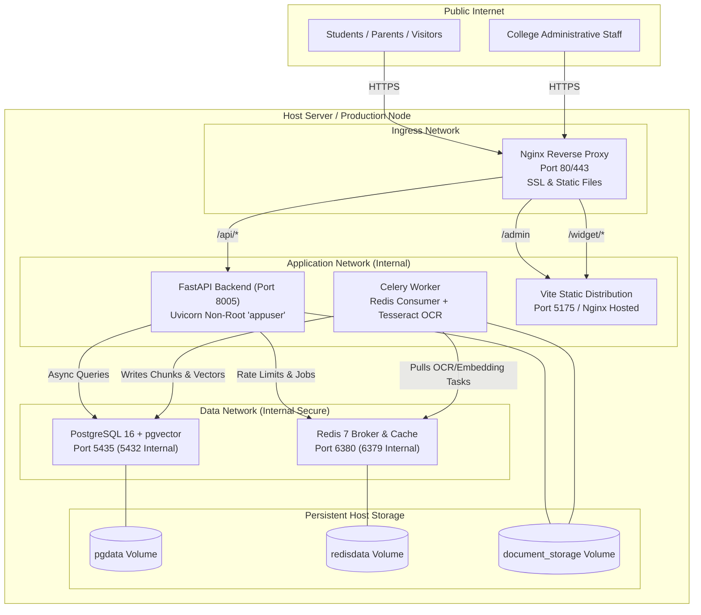

# Production Deployment & Infrastructure Operations Guide
**Document Version:** 2.0 (Post-Audit Verified)  
**Target Platform:** Linux Virtual Machine / Docker Compose / Kubernetes  

---

## 1. Container Topology & Architecture

The **College AI Help Desk** uses containerized services with isolated network boundaries.



---

## 2. Multi-Stage Dockerfile Specification

The backend service runs inside a multi-stage, unprivileged Debian slim container (`backend/Services/HelpdeskService/Dockerfile`):

- **Builder Stage**: Compiles C extensions (`gcc`, `libpq-dev`) and installs dependencies to `/root/.local`.
- **Runtime Stage**:
  - Copies wheel binaries to `/home/appuser/.local`.
  - Installs runtime dependencies: `libpq5`, `tesseract-ocr`, `tesseract-ocr-tam` (Tamil OCR package), and `curl`.
  - Runs under unprivileged user `appuser` (UID 1001, GID 1001).
  - Healthcheck probe: `curl -f http://localhost:8005/health || exit 1`.

### Building and Running via Docker Compose
```bash
# Build and run the entire stack
docker compose --profile full-stack up --build -d

# Verify container health status
docker compose ps
```

---

## 3. Reverse Proxy Configuration (Nginx)

When placing the application behind an institutional reverse proxy (e.g., Nginx), client IP forwarding and WebSocket/SSE buffering must be properly configured:

```nginx
server {
    listen 443 ssl http2;
    server_name helpdesk.college.edu;

    ssl_certificate /etc/ssl/certs/college_cert.pem;
    ssl_certificate_key /etc/ssl/private/college_key.pem;

    # Security headers
    add_header X-Content-Type-Options nosniff always;
    add_header X-Frame-Options SAMEORIGIN always;
    add_header X-XSS-Protection "1; mode=block" always;

    # Public and Admin API routing
    location /api/ {
        proxy_pass http://127.0.0.1:8005;
        proxy_set_header Host $host;
        proxy_set_header X-Real-IP $remote_addr;
        proxy_set_header X-Forwarded-For $proxy_add_x_forwarded_for;
        proxy_set_header X-Forwarded-Proto $scheme;

        # Disable buffering for Server-Sent Events (SSE) streaming chat
        proxy_buffering off;
        proxy_cache off;
        proxy_read_timeout 120s;
    }

    # Frontend Single Page Application
    location / {
        root /var/www/college-helpdesk/dist;
        try_files $uri $uri/ /index.html;
    }
}
```

---

## 4. Database Migrations & Indexing Architecture

### 4.1 Migration Management
Alembic manages database schema versions synchronously via psycopg2:
```bash
cd backend/Services/HelpdeskService
/home/ybdeveloper/Ramesh-Test123/Help-Desk/college-ai-helpdesk/backend/.venv/bin/alembic upgrade head
```

### 4.2 Verified Indexes
| Table | Index Name | Type | Purpose |
| :--- | :--- | :--- | :--- |
| `document_chunks` | `idx_chunks_embedding_hnsw` | **HNSW (pgvector)** | Accelerates dense cosine distance queries (`m=16, ef_construction=64`). |
| `document_chunks` | `idx_chunks_search_vector_gin` | **GIN** | Accelerates full-text keyword search (`to_tsvector`). |
| `document_chunks` | `ix_document_chunks_document_id` | B-tree | Fast join and foreign key lookup. |
| `documents` | `ix_documents_department_id` | B-tree | Department-level document filtering. |
| `tickets` | `ix_tickets_department_id` | B-tree | Department ticket triage filtering. |
| `tickets` | `ix_tickets_status` | B-tree | Status lifecycle state queries. |
| `ticket_otps` | `ix_ticket_otps_email` | B-tree | Fast OTP verification lookup. |

---

## 5. Automated Database Backups & Restore Drills

### 5.1 Backup Script (`scripts/backup.sh`)
Executes `pg_dump` with custom compressed archive format (`.dump`) and records SHA-256 integrity checksums:
```bash
bash scripts/backup.sh
# Creates: backups/helpdesk_db_YYYYMMDD_HHMMSS.dump
# Creates: backups/helpdesk_db_YYYYMMDD_HHMMSS.dump.sha256
```

### 5.2 Disaster Recovery & Verification Drill (`scripts/restore_drill.sh`)
Validates backup archive integrity without mutating active production data:
```bash
bash scripts/restore_drill.sh
# Verifies:
# 1. SHA-256 checksum integrity match
# 2. pg_restore --list archive TOC readability
# 3. Restores schema into temporary test database
# 4. Verifies presence of core tables (documents, document_chunks, tickets, users)
# 5. Drops temporary drill database cleanly
```

---

## 6. Health & Readiness Probes

| Endpoint | Method | Scope | Checks Performed |
| :--- | :---: | :---: | :--- |
| `/health` | GET | Root | Basic container ping for Docker/Kubernetes liveness. |
| `/api/v1/public/health` | GET | Public | Validates PostgreSQL connectivity, pgvector extension, and Redis broker. |
| `/api/v1/admin/health` | GET | Admin | Deep inspection including active document count and worker queue lengths. |
| `/api/v1/public/config` | GET | Public | Returns college branding, active academic year, and widget configuration. |
